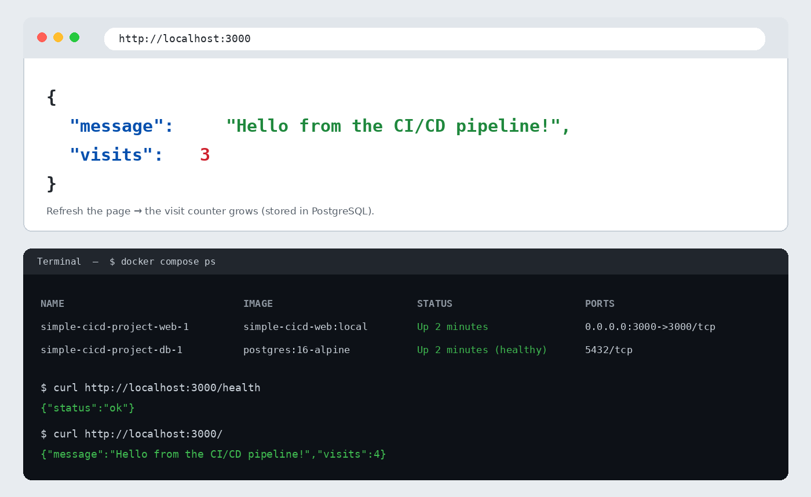
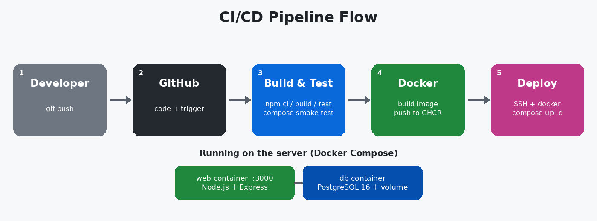
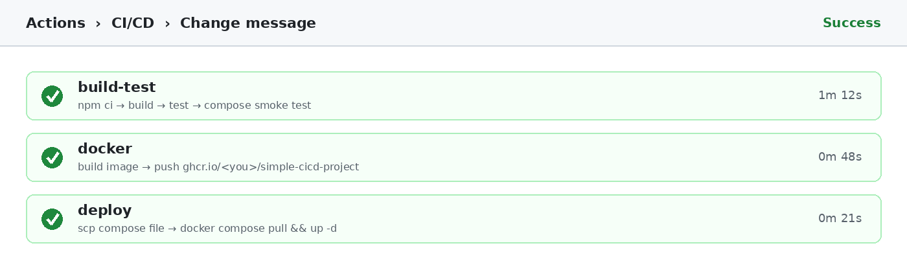

# Simple CI/CD Pipeline

A beginner-friendly end-to-end CI/CD project that demonstrates how a Node.js web application can be automatically built, tested, containerized, published, and optionally deployed whenever code is pushed to GitHub.

The application uses **Express** for the web server and **PostgreSQL 16** to store a page-visit counter. Docker Compose runs the web application and database as two containers.

> **Project scope:** This repository contains the application and CI/CD configuration. Running it locally is optional if your goal is only to study or demonstrate the GitHub repository.

## Screenshots

### Application running with Docker Compose

The home endpoint returns a JSON message and the number of visits stored in PostgreSQL. Refreshing the page increases the visit count.



### CI/CD pipeline flow



### Successful GitHub Actions workflow

The example workflow run shows all three jobs—`build-test`, `docker`, and `deploy`—completing successfully. Deployment runs only when it has been enabled and the required server secrets are configured.



## Technologies

| Technology | Purpose |
|---|---|
| GitHub | Hosts the source code and triggers workflows |
| GitHub Actions | Automates build, test, image publishing, and deployment |
| Node.js + Express | Runs the web application |
| npm | Installs dependencies and runs build/test scripts |
| PostgreSQL 16 | Stores the page-visit counter |
| Docker | Packages the web application into an image |
| Docker Compose | Runs the web and database containers together |
| GitHub Container Registry (GHCR) | Stores the published Docker image |
| SSH | Connects the deployment workflow to the Linux server |

## Project structure

```text
simple-cicd-project/
├── .github/
│   └── workflows/
│       └── ci-cd.yml       # GitHub Actions workflow
├── test/
│   └── app.test.js         # Automated application test
├── images/
│   ├── output.png          # Application / container screenshot
│   ├── pipeline.png        # CI/CD flow diagram
│   └── actions.png         # GitHub Actions result screenshot
├── server.js               # Express application and PostgreSQL logic
├── package.json            # npm scripts and dependencies
├── package-lock.json       # Locked npm dependency versions
├── Dockerfile              # Builds the web application image
├── docker-compose.yml      # Defines web and PostgreSQL services
├── .env.example            # Example environment configuration
├── .dockerignore            # Files excluded from Docker build context
├── .gitignore               # Files excluded from Git
├── MANUAL.md                # Detailed setup and deployment manual
└── README.md                # Project documentation
```

## CI/CD workflow

The workflow is defined in `.github/workflows/ci-cd.yml`.

| Job | Main steps | When it runs |
|---|---|---|
| **1. `build-test`** | Installs dependencies with `npm ci`, runs the build and tests, starts the Docker Compose stack, and checks the `/health` and `/` endpoints | Pushes and pull requests |
| **2. `docker`** | Builds the Docker image and pushes it to `ghcr.io/<owner>/<repository>` | Pushes to `main`, after `build-test` succeeds |
| **3. `deploy`** | Connects to the Linux server over SSH, transfers the Compose file, pulls the new image, and runs `docker compose up -d` | Pushes to `main`, after the Docker job succeeds, and only when deployment is enabled |

### Pipeline flow

1. A developer pushes code to GitHub.
2. GitHub Actions starts the workflow.
3. The `build-test` job installs dependencies and validates the application.
4. The `docker` job builds and publishes the container image to GHCR.
5. If deployment is enabled, the `deploy` job updates the application on the configured server.

Pull requests run the validation job; image publishing and deployment are restricted to pushes to `main`.

## Run locally (optional)

### Requirements

- Node.js and npm, if running without containers
- Docker with the Docker Compose plugin, if running the full stack

### Run with Docker Compose

```bash
docker compose up --build
```

Open:

- Application: <http://localhost:3000>
- Health check: <http://localhost:3000/health>

The home endpoint returns a response similar to:

```json
{
  "message": "Hello from the CI/CD pipeline!",
  "visits": 1
}
```

The `visits` value increases when the home endpoint is requested.

Stop the containers:

```bash
docker compose down
```

To also remove the database volume and its stored visit data:

```bash
docker compose down -v
```

### Run tests without Docker (optional)

```bash
npm install
npm test
```

The full integration check uses Docker Compose as part of the GitHub Actions workflow.

## Push the project to GitHub

Create a GitHub repository, then run these commands from the project root directory:

```bash
git init
git add .
git commit -m "Initial commit - Simple CI/CD Pipeline"
git branch -M main
git remote add origin https://github.com/<your-username>/<your-repository>.git
git push -u origin main
```

After pushing, open the repository's **Actions** tab to view the workflow run.

If the image-publishing job receives a permission error, check:

**Repository → Settings → Actions → General → Workflow permissions → Read and write permissions**

Save the setting and rerun the workflow if needed.

## Enable deployment (optional)

Deployment requires a Linux server (for example, an AWS EC2 instance or another VPS) with Docker installed and SSH access enabled.

Add the following under:

**Repository → Settings → Secrets and variables → Actions**

| Type | Name | Value |
|---|---|---|
| Secret | `SERVER_HOST` | Public IP address or hostname of the server |
| Secret | `SERVER_USER` | SSH username, such as `ubuntu` |
| Secret | `SERVER_SSH_KEY` | Private SSH key used by GitHub Actions |
| Secret | `DB_PASSWORD` | Strong database password |
| Variable | `DEPLOY_ENABLED` | `true` |

Also ensure that:

- Docker and the Docker Compose plugin are installed on the server.
- The deployment SSH public key is present in the server user's `~/.ssh/authorized_keys`.
- The server firewall or cloud security group allows the required application traffic on port `3000`.
- The workflow has the permissions needed to publish and pull the GHCR image.

**Security note:** Never commit private SSH keys, real passwords, `.env` files, or other secrets to the repository. Store deployment credentials only in GitHub Actions secrets.

For the complete server setup and SSH-key instructions, see [MANUAL.md](MANUAL.md).

## API endpoints

| Method | Endpoint | Purpose | Example response |
|---|---|---|---|
| `GET` | `/` | Returns the welcome message and visit count | `{"message":"Hello from the CI/CD pipeline!","visits":1}` |
| `GET` | `/health` | Reports application health | `{"status":"ok"}` |

## Configuration

The Compose configuration supplies defaults. Use `.env.example` as a reference when creating a local `.env` file to override them.

| Environment variable | Example/default |
|---|---|
| `DB_USER` | `appuser` |
| `DB_PASSWORD` | `apppass` (change this outside local demonstrations) |
| `DB_NAME` | `appdb` |

Do not use the example database password for a public or production deployment.

## Troubleshooting

| Issue | What to check |
|---|---|
| `npm ci` fails | Confirm `package-lock.json` is present and committed |
| GHCR permission denied | Check the workflow's package permissions and repository workflow permissions |
| Deployment job is skipped | Confirm the Actions variable `DEPLOY_ENABLED` is set to `true` |
| SSH deployment fails | Check `SERVER_HOST`, `SERVER_USER`, `SERVER_SSH_KEY`, and the server's `authorized_keys` |
| Application is unreachable | Check container status, port mapping, and server firewall/security-group rules |
| Local port `3000` is already in use | Change the host-side port mapping in `docker-compose.yml` |

## Learning outcomes

By exploring this project, you can understand:

- The difference between Continuous Integration and Continuous Deployment.
- How GitHub Actions automates software workflows.
- How npm installs dependencies and runs scripts.
- How Docker images package an application consistently.
- How Docker Compose coordinates an application and its database.
- How GHCR stores container images.
- How SSH can be used for automated deployment.

## Documentation

See [MANUAL.md](MANUAL.md) for the detailed step-by-step instructions, including GitHub setup, GHCR permissions, server preparation, SSH keys, and deployment configuration.
